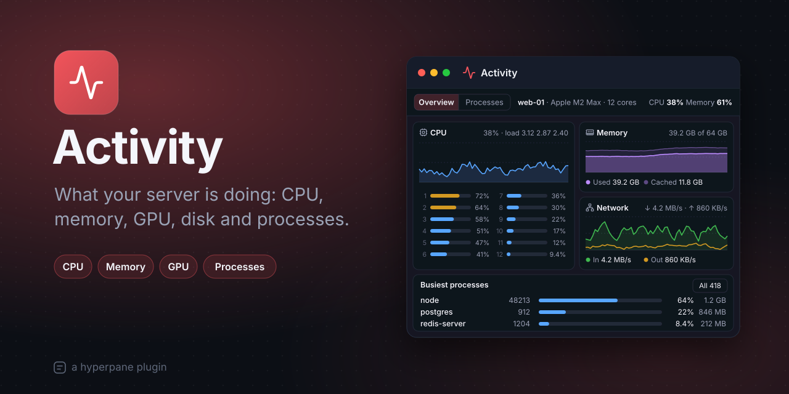

# Activity

What your server is doing: CPU, memory, GPU, disk and processes. Activity
shows the machine the app is connected to as Activity Monitor or htop
would: every core charted over the last five minutes, and the processes
behind the numbers, ready to end.

## Features

- **CPU:** in all and every core as a bar, with the load average.
- **Memory:** used and cached, and swap.
- **GPU:** each one's load, and its memory, temperature and power when it
  says.
- **Network and disk:** in and out, reads and writes, and how full each
  volume is.
- **Charts for the last 5 minutes:** hover one for its values.
- **Busiest processes** on the overview, at a glance.
- **Every process:** its CPU, memory, threads, user and start time; sort by
  any column, search by name, command or pid, show only yours, or see them
  as a tree under their parents.
- **End or force quit** a process; both ask first.

## How to use

1. Open Activity: **+** on the project, **New activity**, or right-click
   the canvas.
2. **Overview** shows the charts, with the busiest processes below. Click
   **All** to see every process.
3. On **Processes**, click a column's title to sort by it, type in the
   search box to filter, tick **Mine** for your own, or switch to the tree.
4. Select a process to see its command line, then **End** (SIGTERM) or
   **Force quit** (SIGKILL) it.

## Good to know

- Readings are taken every 2 seconds while an Activity window is open, and
  the last 5 minutes are kept: a window opened while another one is
  showing starts with what's been read. With none open, nothing is read.
- The server runs as you: other users' processes can be seen, not ended.
- What a system can't say is left out, not shown as an error.
- Works on macOS, Linux and Windows servers.

## How it works

The server part reads the numbers from the system itself, with no agent to
install:

| | macOS | Linux | Windows |
| --- | --- | --- | --- |
| CPU | Node (`os.cpus()`), per core | the same | the same |
| Memory | `vm_stat` (app, wired and compressed: as Activity Monitor), `sysctl vm.swapusage` | `/proc/meminfo` (MemAvailable) | Node |
| Network | `netstat -ibn` | `/proc/net/dev` | CIM performance counters |
| Disk | `ioreg` (IOBlockStorageDriver) | `/proc/diskstats` (whole disks) | CIM performance counters |
| GPU | `ioreg` (IOAccelerator: Apple's GPU) | `nvidia-smi`; AMD and Intel from `/sys/class/drm` | `nvidia-smi` |
| Volumes | `df -kP` (the Data volume as /) | `df -kP` | CIM |
| Processes | `ps` (its %CPU is recent) | `/proc/<pid>` (CPU since the last reading) | CIM `Win32_Process` |

## Develop

```sh
./build.sh --test
```

## License

MIT, © 2026 Astralyx. See [LICENSE](LICENSE).
